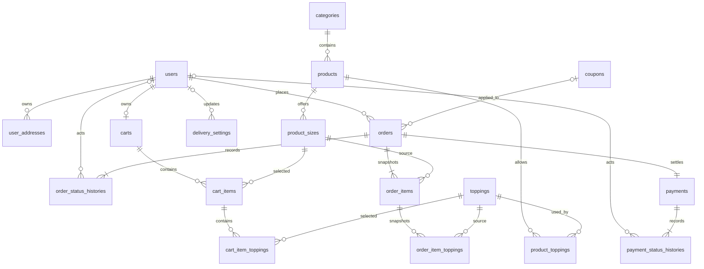

# Thiết kế cơ sở dữ liệu Coffee Shop

## 1. Phạm vi và quy ước

Thiết kế MVP thống kê **25 bảng**, gồm **18 bảng nghiệp vụ** (1 bảng `users` đã có và 17 bảng mới) và **7 bảng hạ tầng Laravel đã có**. Base Project có 8 bảng từ ba migration mặc định. Bảng theo dõi `migrations` do Laravel quản lý nằm ngoài thống kê, nghĩa là 26 bảng vật lý nếu tính thêm bảng đó. UC mở rộng cần thiết kế bổ sung khi nhà cung cấp được chọn.

Dùng MySQL InnoDB, `utf8mb4`, PK `BIGINT UNSIGNED` cho bảng nghiệp vụ và số nguyên `BIGINT UNSIGNED` cho tiền VND. Lưu thời gian theo UTC, hiển thị và xác định khoảng ngày theo `Asia/Ho_Chi_Minh`. Trạng thái có tập giá trị xác định, dùng enum phía ứng dụng và ràng buộc DB phù hợp. Các bảng nghiệp vụ có timestamps khi cần truy vết. Snapshot JSON có schema do ứng dụng kiểm tra và chỉ chứa dữ liệu cần cho đơn.

## 2. Từ điển dữ liệu MVP

| Bảng | Trường chính và quan hệ | Ràng buộc và truy vấn |
| --- | --- | --- |
| `users` (mở rộng) | `id`, `name`, `email`, `password` hash, `role`, `is_active`, thông tin Fortify hiện có | Email chuẩn hóa unique. Vai trò mặc định customer. Thay đổi vai trò chỉ qua UC04. |
| `user_addresses` | `id`, `user_id` → users, người nhận, điện thoại, tỉnh/thành, quận/huyện, phường/xã, địa chỉ chi tiết, `is_default` | Index `user_id`. Unique khóa sinh nullable theo `user_id` khi là địa chỉ mặc định. Khóa user khi đổi mặc định. |
| `categories` | `id`, `name`, `slug`, `is_active`, `sort_order` | Slug unique. Index trạng thái/thứ tự. |
| `products` | `id`, `category_id`, `name`, `slug`, mô tả, đường dẫn ảnh, `is_active`, `allows_sugar`, `allows_ice` | Slug unique. Index `category_id,is_active`. Ảnh lưu qua Laravel filesystem. |
| `product_sizes` | `id`, `product_id`, `code`, `label`, `price_vnd`, `is_active` | Unique `product_id,code`. Giá đầy đủ của một ly theo size. |
| `toppings` | `id`, `code`, `name`, `price_vnd`, `is_active` | Code unique. Ngừng bán nếu đã có tham chiếu. |
| `product_toppings` | `id`, `product_id`, `topping_id` | Unique cặp sản phẩm và topping. |
| `carts` | `id`, `user_id`, `version` | Unique `user_id`. Tăng version sau mỗi thay đổi. |
| `cart_items` | `id`, `cart_id`, `product_size_id`, `configuration_hash`, `quantity`, `sugar_level`, `ice_level` | Unique `cart_id,configuration_hash`. Hash từ size, đường, đá và tập ID topping sắp xếp. Quantity > 0. |
| `cart_item_toppings` | `id`, `cart_item_id`, `topping_id` | Unique cặp. Xóa cùng dòng giỏ. |
| `delivery_settings` | `id`, `delivery_enabled`, `flat_fee_vnd`, `eligible_districts` JSON, `updated_by` → users nullable | Một bản ghi cấu hình với ID cố định. Mã vùng lấy từ danh sách đã chuẩn hóa. |
| `coupons` | `id`, `code`, `discount_type`, `discount_value`, `min_subtotal_vnd`, `max_discount_vnd`, `starts_at`, `ends_at`, `total_limit`, `per_user_limit`, `is_active` | Code chuẩn hóa unique. Khoảng thời gian hợp lệ và giá trị dương. Phần trăm từ 1 đến 100. Null ở các giới hạn tùy chọn nghĩa là không giới hạn. |
| `orders` | `id`, `user_id`, `order_number`, `checkout_key`, `request_hash`, `coupon_id` nullable, snapshot mã và người nhận/địa chỉ, `fulfillment_type`, `status`, `subtotal_vnd`, `discount_vnd`, `delivery_fee_vnd`, `total_vnd`, `completed_at` nullable | Unique mã đơn và `user_id,checkout_key`. Index theo `user_id,created_at`, `status,created_at`, `coupon_id,status,user_id` và `status,completed_at`. |
| `order_items` | `id`, `order_id`, `product_size_id`, snapshot tên món và size, đường/đá, `quantity`, `base_unit_price_vnd`, `line_total_vnd` | Giữ giá size gốc và tổng dòng. Dữ liệu lịch sử đọc từ snapshot. |
| `order_item_toppings` | `id`, `order_item_id`, `topping_id`, snapshot tên và `unit_price_vnd` | Unique cặp dòng và topping. Giá trên một ly. |
| `payments` | `id`, `order_id`, `method`, `status`, `amount_vnd`, `collection_reference`, `refund_reference`, `paid_at`, `refunded_at` | Một payment/đơn. Unique `method,collection_reference` khi có tham chiếu. Số tiền bằng tổng đơn. |
| `order_status_histories` | `id`, `order_id`, `actor_id` → users nullable, `from_status`, `to_status`, `reason`, `created_at` | Append-only. Index `order_id,id`. Actor null dành cho sự kiện hệ thống. |
| `payment_status_histories` | `id`, `payment_id`, `actor_id` → users nullable, `from_status`, `to_status`, `reason`, `created_at` | Append-only. Index `payment_id,id`. |

Bảy bảng hạ tầng đã có gồm `password_reset_tokens`, `sessions`, `cache`, `cache_locks`, `jobs`, `job_batches` và `failed_jobs`. Bảng `users` đã được tính ở nhóm nghiệp vụ.

## 3. ERD nghiệp vụ

## 4. Tính toàn vẹn và đồng thời

- Với giỏ và địa chỉ chưa chốt, cho phép xóa theo quyền sở hữu và cascade dòng con phù hợp. Với đơn, khoản thu, lịch sử và danh mục đã tham chiếu, ưu tiên FK restrict và vô hiệu hóa thay cho xóa.
- Checkout dùng transaction với thứ tự khóa giỏ rồi mã giảm khi có. Kiểm tra lại phiên bản giỏ, quyền, tùy chọn, giá và tổng đã xác nhận. Đếm đơn còn hiệu lực bằng dữ liệu hiện hành ở MySQL sau khi khóa mã, tránh snapshot cũ khi chờ đồng thời. Unique idempotency chống xử lý lặp và request hash phân biệt nội dung. Kiểm tra khóa đã dùng trước khi yêu cầu giỏ còn dòng để retry sau chốt hoạt động.
- Cập nhật đơn và payment khóa đơn trước payment, kiểm tra trạng thái kỳ vọng, ghi lịch sử cùng giao dịch. Khi giải phóng lượt mã, checkout vẫn bảo toàn giới hạn nhờ hàng mã được dùng làm điểm tuần tự hóa khi cấp lượt. Các quy tắc chuyển trạng thái nằm trong [quy trình đơn hàng](ORDER_WORKFLOW.md).
- Migrate theo thứ tự người dùng, catalog, giỏ/cấu hình, đơn/payment/lịch sử. Thử forward migration trên MySQL riêng có dữ liệu mô phỏng và thử rollback với bản sao thử nghiệm. Dùng SQLite trong PHPUnit cho luồng độc lập engine, dùng MySQL cho khóa hàng, ràng buộc sinh và đồng thời.
