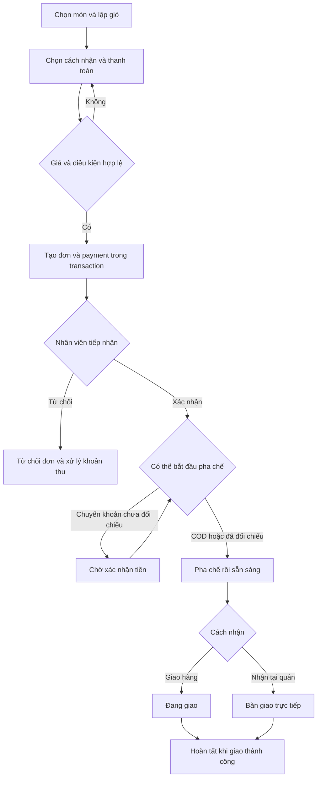

# Quy trình đặt hàng và thanh toán

## 1. Từ giỏ đến đơn

1. Khách chốt phương thức nhận, thông tin liên hệ, phương thức thanh toán và mã giảm nếu có. Backend kiểm tra lại dữ liệu và báo tổng VND hiện hành.
2. Khách xác nhận tổng. Hệ thống khóa giỏ, kiểm tra phiên bản và giá, khóa mã ưu đãi nếu dùng rồi tạo đơn `pending`, các dòng snapshot và payment `pending`. Giỏ chỉ được làm trống trong giao dịch thành công. Nếu khách gửi lại cùng khóa và nội dung, trả lại đơn hiện có.
3. Xác nhận đặt hàng hiển thị mã đơn, cách nhận, tổng và hướng dẫn chuyển khoản nếu chọn. Thao tác xác nhận thủ công đi qua UC20.

## 2. Chuyển trạng thái đơn

| Từ | Sang | Ai thực hiện | Điều kiện |
| --- | --- | --- | --- |
| — | `pending` | Khách | Checkout thành công. Tạo payment `pending`. |
| `pending` | `confirmed` | Nhân viên hoặc admin | Đơn có thể tiếp nhận. |
| `pending` | `rejected` | Nhân viên hoặc admin | Bắt buộc lý do. Xử lý payment theo BR15. |
| `pending` | `cancelled` | Chủ đơn hoặc admin | Chủ đơn xác nhận hủy. Admin nhập lý do. |
| `confirmed` | `preparing` | Nhân viên hoặc admin | COD hoặc chuyển khoản đã `paid`. |
| `preparing` | `ready` | Nhân viên hoặc admin | Món đã chuẩn bị. |
| `ready` | `out_for_delivery` | Nhân viên hoặc admin | Chỉ đơn giao và đã bàn giao cho người giao của cửa hàng. |
| `ready` | `completed` | Nhân viên hoặc admin | Chỉ đơn nhận tại quán, đã giao khách và đã thu tiền. |
| `out_for_delivery` | `completed` | Nhân viên hoặc admin | Đã giao khách và đã thu tiền. |
| `confirmed`, `preparing`, `ready` | `cancelled` | Admin | Bắt buộc lý do. Xử lý payment theo BR15. |

`completed`, `cancelled` và `rejected` là trạng thái kết thúc. Cùng một trạng thái nghiệp vụ, lỗi ghi giữa chừng hoặc yêu cầu cũ bị xử lý theo transaction và kiểm tra trạng thái kỳ vọng. Nếu khách muốn hủy sau `pending`, giao thất bại ở `out_for_delivery` hoặc có sự cố sau hoàn tất, chuyển yêu cầu qua hỗ trợ của cửa hàng để xử lý thủ công.

## 3. Chuyển trạng thái thanh toán

| Chuyển | Điều kiện và kết quả |
| --- | --- |
| `pending → paid` | Chuyển khoản đối chiếu đúng tổng đơn và mã giao dịch trước pha chế. Với đơn 0 ₫, nhân viên xác nhận đã đủ điều kiện thanh toán, không cần mã giao dịch. COD xác nhận số tiền thu cùng thao tác hoàn tất. Ghi actor, thời điểm và tham chiếu khi có. |
| `pending → voided`, `paid → voided` | Đơn bị từ chối hoặc hủy khi chưa phát sinh khoản thu, kể cả đơn 0 ₫ đã được xác nhận thanh toán. |
| `paid → refund_pending` | Đơn bị từ chối hoặc hủy sau khi đã nhận tiền. |
| `refund_pending → refunded` | Admin kiểm tra tiền hoàn ngoài hệ thống và ghi tham chiếu hoàn. |

Sai số tiền, thiếu tham chiếu cho khoản thu, nhập trùng tham chiếu chuyển khoản hay nhận tiền sau hủy cần đối chiếu thủ công. Yêu cầu lỗi giữ nguyên trạng thái, không ghi nhận một khoản thu mới. Doanh thu áp dụng BR17. Nhật ký nghiệp vụ và thông tin hiển thị cho khách tuân theo BR18.

## 4. Nhận tại quán theo lịch hẹn

[UC26](use-cases/UC26.md) bổ sung giờ hẹn và phiếu điện tử vào đơn nhận tại quán. Staff/admin xác minh mã và ghi nhận lúc khách đến để tính phí trễ, sau đó bàn giao theo UC19 khi đơn sẵn sàng và đủ điều kiện thanh toán. Đơn hủy hoặc bị từ chối làm phiếu mất hiệu lực. Với đơn hẹn chưa ghi nhận khách đến sau 30 phút, ghi lý do hủy là không đến và xử lý khoản tiền của đơn theo BR15. [UC27](use-cases/UC27.md) có lịch đặt bàn/phòng riêng. Check-in không tạo đơn đồ uống. Phụ phí của cả hai UC theo BR26–BR27.
